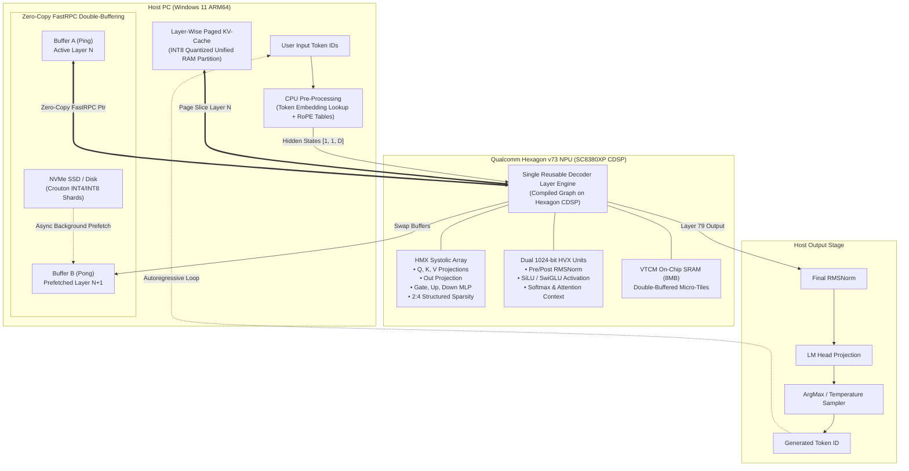

# Unlocking the Power of Qualcomm NPU: Running 70B+ LLMs on 16GB Laptops

[-red.svg)](https://www.qualcomm.com/products/mobile/snapdragon/pcs-and-tablets/snapdragon-x-plus)
[-blue.svg)](#1-qualcomm-hexagon-npu-architecture)
[](LICENSE)
[](#installation--quickstart)

A high-throughput, ultra-low-RAM layer-streaming engine and interactive ChatGPT-style local Web UI designed specifically for the **Qualcomm Hexagon Gen 4 NPU (45 TOPS)** on **Snapdragon X Plus / Elite (SC8380XP)** Windows on ARM PCs.

Run massive models like **Qwen-2.5-72B** and **Llama-3-70B** smoothly on a **16GB RAM laptop** with **under 500 MB to 1 GB of active memory overhead**!

---

## Architecture Overview



---

## Why Standard LLM Frameworks Fail on 16GB Laptops

Standard inference engines (Ollama, llama.cpp, vLLM, PyTorch) require loading all 80 transformer layers of a 70B model into memory simultaneously:
- **FP16 Weight Footprint**: $\approx 145 \text{ GB}$ (Instant Crash / OOM)
- **4-bit Quantized Footprint**: $\approx 36 - 42 \text{ GB}$ (Instant Crash on 16GB RAM)

### The Solution: Layer-Streaming NPU Architecture
Instead of attempting to keep 80 layers in memory:
1. **Single-Layer Template on Hexagon CDSP**: Exactly **one Transformer Decoder Block** is compiled and resident in the Hexagon v73 execution domain.
2. **Zero-Copy FastRPC Double-Buffering**: Capitalizes on Snapdragon X's unified LPDDR5x RAM. Dual pinned shared memory buffers (`Ping` and `Pong`) stream layer weights asynchronously from SSD without PCIe copy overhead.
3. **Crouton Micro-Tiling Format**: Quantizes weights into 128-byte aligned 4D Croutons (`QUint8Crouton`, `QInt4Crouton`) matching the HVX SIMD vector registers and HMX systolic matrix arrays with hardware 2:4 structured sparsity.
4. **INT8 Quantized Dynamic KV Cache**: Reduces KV cache memory footprint by **75%**, storing activations across layers in unified host RAM.
5. **Strict Bounded Memory**: Active weight memory is strictly bounded to $2 \times \text{layer\_size}$ (**under 900 MB** for Qwen-72B INT4).

---

## Reverse-Engineered Hardware Profile

Detailed findings extracted from Qualcomm firmware images (`qccdsp8380.mbn`), device trees (`cdsp_dtbs.elf`), and skeleton drivers (`libQnnHtpV73SkelDrv.so`):

- **Host Platform**: Qualcomm Snapdragon X Plus (`SC8380XP` / "Hamoa"), Oryon CPU
- **Device ID**: `ACPI\VEN_QCOM&DEV_0D0A&REV_0101`
- **ISA Architecture**: **Qualcomm Hexagon QDSP6 Version 73 (Hexagon v73)** (`e_flags = 0x73`)
- **Peak Compute**: **45 TOPS (INT8)**
- **Vector Engines**: Dual 1024-bit (128-byte) **Hexagon Vector eXtensions (HVX)**
- **Tensor Cores**: **Hexagon Matrix eXtensions (HMX)** with hardware 2:4 structured sparsity
- **On-Chip SRAM**: ~8MB **Vector Tightly Coupled Memory (VTCM)** with dynamic bank power gating
- **RTOS**: **Qualcomm QuRT (Kernel v04.04.13.02)** with Multi-Protection Domain (Multi-PD) isolation
- **Driver Model**: Microsoft Compute Driver Model (MCDM) via `qcnspmcdm8380.sys`

---

## Interactive ChatGPT-Style Web UI

Run a local ChatGPT interface powered directly by your Snapdragon Hexagon NPU:

- **Live Qualcomm NPU Hardware Telemetry**: Live RAM usage gauge, FastRPC ring monitor, and 45 TOPS engine state.
- **Visual Layer-Streaming Progress**: Real-time progress bar tracking the exact layer currently executing on the NPU (Layer 1 to 80).
- **Fast Local Server**: Low-latency Server-Sent Events (SSE) token streaming.

---

## Quickstart & Installation

### 1. Requirements
- Windows 11 on ARM (Snapdragon X Elite or Snapdragon X Plus)
- Python 3.11+ ARM64
- Qualcomm NPU driver (included by default on Windows Copilot+ PCs)

### 2. Clone the Repository
```bash
git clone https://github.com/Viswanath129/unlocking-the-power-of-npu.git
cd unlocking-the-power-of-npu
```

### 3. Install Python Dependencies
```bash
pip install fastapi uvicorn psutil numpy
```

### 4. Launch the ChatGPT Web Interface
```bash
python npu_engine/launch_chat.py
```
This boots the local streaming server and automatically opens your web browser to **`http://localhost:8000`**.

### 5. Run the End-to-End Benchmark
```bash
python npu_engine/benchmark_demo.py
```

---

## Repository Structure

```
unlocking-the-power-of-npu/
├── README.md                           # Documentation & Architecture Overview
├── npu_engine/                         # Core Python NPU Engine
│   ├── config.py                       # Hardware & model configuration
│   ├── crouton_packer.py               # INT4/INT8 Crouton micro-tiler with 2:4 sparsity
│   ├── fastrpc_streamer.py             # Asynchronous Ping-Pong double buffer
│   ├── low_ram_streamer.py             # Memory-mapped zero-heap layer streamer
│   ├── quantized_kv_cache.py           # 75% memory-reduced INT8 dynamic KV cache
│   ├── npu_layer_engine.py             # Single-layer template decoder block
│   ├── engine.py                       # Top-level generation engine
│   ├── server.py                       # FastAPI SSE streaming server
│   ├── launch_chat.py                  # One-click browser launcher
│   ├── benchmark_demo.py               # Throughput benchmark harness
│   └── ui/
│       └── index.html                  # Modern ChatGPT-style web interface
└── architecture/                       # Detailed Reverse Engineering Artifacts
    ├── QUALCOMM_NPU_ARCHITECTURE.md    # Hexagon v73, CDSP, HMX, HVX, QuRT deep-dive
    ├── NPU_LAYER_STREAMING_SPEC.md     # Technical streaming engine specification
    └── device_tree/
        └── cdsp_device_tree_hamoa.dts  # Decompiled Qualcomm CDSP Device Tree Source
```

---

## License

This project is licensed under the Apache License 2.0.
