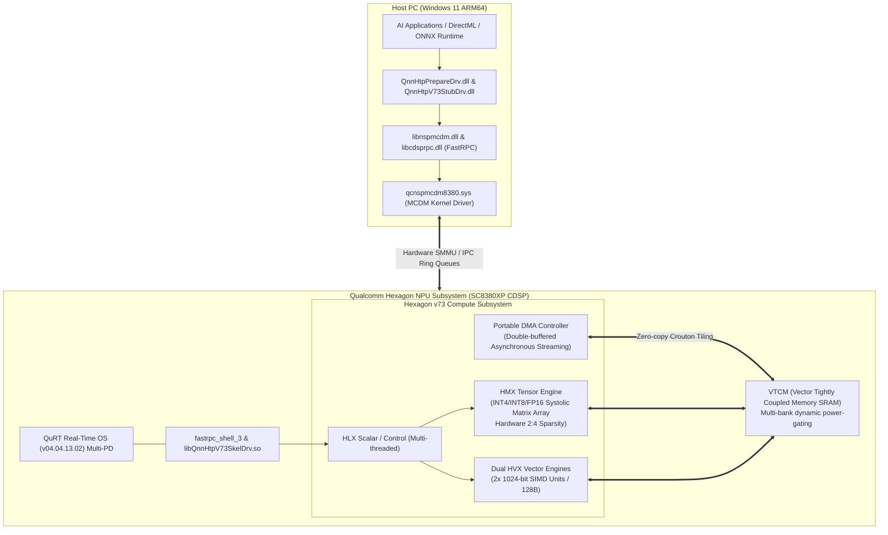
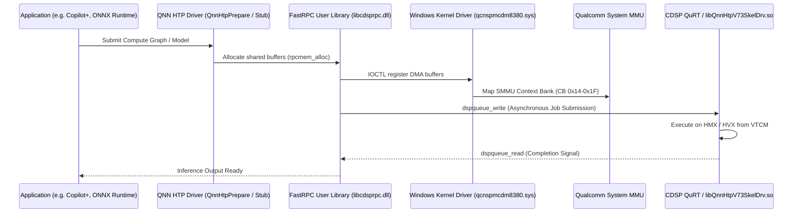

# Qualcomm Hexagon NPU Architecture Deep-Dive

**Target System**: Snapdragon(R) X Plus - X1P42100 - Qualcomm(R) Oryon(TM) CPU (Windows on ARM)  
**SoC Codename**: `SC8380XP` ("Hamoa")  
**Device Hardware ID**: `ACPI\VEN_QCOM&DEV_0D0A&REV_0101`  
**NPU Subsystem**: Qualcomm Hexagon Gen 4 NPU (45 TOPS Peak INT8)  
**Date**: November 2026  

---

## 1. Executive Architecture Summary

The Qualcomm NPU is the **Hexagon Gen 4 Neural Processing Unit (NPU)** integrated into the **Snapdragon X Plus (SC8380XP / Hamoa)** platform. Delivering up to **45 TOPS (INT8)**, it is designed specifically for sustained, power-efficient on-device AI inference compliant with Microsoft Copilot+ PC requirements.

The NPU is not a standalone accelerator with separate VRAM; rather, it is a tightly integrated **Compute Digital Signal Processor (CDSP)** operating in unified system memory with dedicated ultra-high-speed on-chip SRAM called **Vector Tightly Coupled Memory (VTCM)** and two primary compute backends:
1. **HMX (Hexagon Matrix eXtensions)**: A systolic tensor engine for dense and sparse matrix multiplication / 2D convolutions.
2. **HVX (Hexagon Vector eXtensions)**: Dual 1024-bit (128-byte) SIMD vector units for non-linear activations, normalizations, and elementwise mathematics.



---

## 2. Hardware Instruction Set & Toolchain

Reverse engineering of the active binary payloads (`libQnnHtpV73SkelDrv.so`, `fastrpc_shell_3`, `qccdsp8380.mbn`) reveals:

- **Core Processor Architecture**: **Qualcomm Hexagon QDSP6 Version 73 (v73)**.
- **ELF Binary Specifications**:
  - `EI_CLASS`: 1 (32-bit ELF)
  - `EI_DATA`: 1 (Little-Endian)
  - `e_machine`: `0x00A4` (164 = `EM_HEXAGON`)
  - `e_flags`: `0x00000073` (Explicit Hexagon ISA version **v73**)
- **Compiler Toolchain**:
  - Compiler: `QuIC LLVM Hexagon Clang version 8.6.06`
  - Linker: `QuIC LLVM Hexagon Linker version 13.0`
  - Build CRM Tag: `CDSP.HT.2.9.c1-00046.1-HAMOA-1_20250609_052617`
  - Target Compile Flags: `-mv73 -nostdlib -shared -Bdynamic --gc-sections`

---

## 3. Compute Engines: HMX, HVX, and HLX

The Hexagon v73 core orchestrates three distinct types of hardware threads:

```
Num HVX threads: %d, Num HMX threads: %d, Num HLX threads: %d
```

### A. HMX (Hexagon Matrix eXtensions / Tensor Core)
The HMX unit is the high-throughput systolic array responsible for matrix multiplication ($C = A \cdot B + C$) and 2D/3D convolutions:
- **Precision Support**:
  - **INT4 (Nibble - `n`)**: Sub-byte weights for highly quantized LLMs (`convbnb`, `convhnh`).
  - **INT8 (Byte - `b`)**: Industry standard quantized inference (`convbbb`).
  - **INT16 / FP16 (Half - `h` / `f16`)**: High-precision activations and weights (`convhhh`, `convf16`).
  - **Mixed Precision**: Inter-mixed inputs, such as INT8 activations with INT4 weights (`convbnb1x1`).
- **Hardware Structured Sparsity**:
  - The v73 HMX hardware features dedicated sparsity decompression circuitry (`_sparsity` kernels in driver).
  - Doubles effective throughput when weights conform to structured 2:4 sparsity patterns.
- **Kernel Patterns Identified**:
  - `hmx_v73_convhhh_5x5_stride1_sparsity`
  - `hmx_v73_convbnb1x1_stride1_sparsity`
  - `hmx_v73_convf16_5x5_stride1`
  - `hmx_v73_convhnh_NxN_stride1`

### B. HVX (Hexagon Vector eXtensions)
HVX comprises **dual 1024-bit (128-byte) SIMD vector coprocessors** (`STREAMING_2HVX_CLIENT_CLASS`):
- **Operating Modes**: Configurable via QuRT in 64-byte or 128-byte vector widths (`QURT_HVX_MODE_128B`).
- **Workloads**:
  - Activation functions: GeLU, SiLU, HardSwish, Sigmoid, Tanh, PReLU (`hvx_hardswish_crouton_u16`).
  - Normalization: LayerNorm, RMSNorm, BatchNorm.
  - Reductions & Sorting: Softmax approximation (`softmax_h_approx_crouton_hvx`), ReduceSum, Top-K, ArgMin/ArgMax.

### C. HLX (Scalar & Control Engine)
The scalar VLIW engine coordinates graph dispatch, handles branch logic, schedules asynchronous DMA transactions, and controls dynamic clock/voltage states.

---

## 4. Memory Hierarchy & "Crouton" Micro-Tiling

Peak compute throughput on an NPU is constrained by memory bandwidth. Qualcomm solves this with an integrated SRAM and micro-tiling architecture:

```
[ System LPDDR5x RAM ] 
         │
         │ (Double-Buffered DMA via PortableDMA, SpillOp / FillOp)
         ▼
[ Vector Tightly Coupled Memory (VTCM) ]  <── Ultra-Low Latency Multi-Bank SRAM
         │
         ├───────────────────────────────┤
         ▼                               ▼
[ Crouton Micro-Tiles ]         [ Crouton Micro-Tiles ]
         │                               │
         ▼                               ▼
 [ HMX Systolic Array ]        [ Dual HVX 1024-bit Units ]
```

### A. VTCM (Vector Tightly Coupled Memory)
- **High-Bandwidth On-Chip SRAM**: Multi-megabyte dedicated buffer directly coupled to HMX and HVX data paths.
- **Dynamic Power Gating**: VTCM is divided into physical banks that power up and down dynamically depending on memory requirements (`Turn off TCM Banks: change_mask:0x%x`).
- **Memory Management**: Managed in QuRT by `/dev/vtcmmgr` with APIs `HAP_request_VTCM` and `HAP_request_async_VTCM`.

### B. The "Crouton" Tensor Data Layout
A major discovery in the decompiled skeleton symbols is Qualcomm's **Crouton tensor format**:
- Traditional tensors are stored in row-major (`NCHW` or `NHWC`) contiguous memory. On wide vector engines, strided access causes severe cache and bank conflicts.
- Qualcomm packs tensors into **Croutons** (`Crouton_8`, `Crouton_16`, `Crouton_32`, `WideCrouton2x2`):
  - 2D/3D micro-tiles matching the exact input dimension of the HMX multiply-accumulate array and the 128-byte HVX vector registers.
  - Eliminates alignment penalties and guarantees zero bank-conflict parallel memory access.

### C. Asynchronous Double-Buffered DMA Streaming
- When network parameters exceed VTCM capacity, the runtime automatically splits layers into tiles using `SpillOp` and `FillOp`.
- Uses `PortableDMA`, `DmaCheckpointSet`, and `DmaCheckpointWait` to stream the next layer's weights into VTCM while the current layer is executing on HMX, achieving near 100% compute unit utilization.

---

## 5. Firmware & Real-Time OS (QuRT)

The NPU firmware image `qccdsp8380.mbn` runs **Qualcomm QuRT (Qualcomm Real-Time Operating System)**:
- **Kernel Version**: `04.04.13.02.00.00.08` (Built June 2025).
- **Multi-PD (Protection Domains)**:
  - **Root Protection Domain (`root_pd`)**: Handles hardware power, clock gating (`sysmon`), thermal throttling, and memory protection.
  - **User Protection Domains (`fastrpc_shell_3`)**: Isolated execution sandboxes for each running application or model instance, preventing a crash in one model from crashing the NPU subsystem.
- **Dynamic Clock & Thermal Governor**:
  - Monitored by `libsysmon_skel.so` and `libsysmonhvxthrottle_skel.so`.
  - Adjusts frequencies across frequency tables: `ADSP_TO_MLHW_FREQ_TABLE_V1`, `FINT_TO_HCP_FREQ_TABLE`, and `ADSP_TO_HSNOC_FREQ_TABLE`.

---

## 6. Windows on ARM Host Driver Stack



1. **Microsoft Compute Driver Model (MCDM)**:
   - Driver: `qcnspmcdm8380.sys` (Device Class: `ComputeAccelerator`).
   - Integrated into Windows Task Manager (showing up under the "NPU" engine).
2. **SMMU Virtualization**:
   - 12 independent CDSP FastRPC context banks (`CBIndex 0x14 - 0x1F`).
   - Hardware Stream IDs: `0x0C01 - 0x0C0F`.
   - Dedicated 4GB virtual address spaces per tenant (`FastRPCCDSPBounds: 0x00000000 to 0xFFFFF000`).
3. **Execution Frameworks Supported**:
   - **Qualcomm Neural Network (QNN) SDK**: Direct, native access to HTP V73 skeleton ops.
   - **DirectML / Windows ML**: Exposed through DXCore adapter GUID `{F01A9D53-3FF6-48D2-9F97-C8A7004BE10C}`.
   - **ONNX Runtime**: QNN Execution Provider (`QNNExecutionProvider`).
